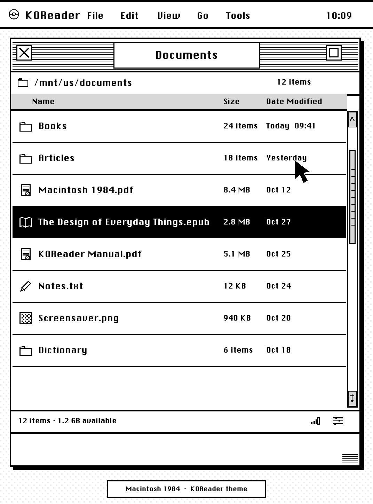

# Macintosh 1984 for KOReader

把 Macintosh 1984 的黑白界面带到 Kindle Paperwhite 4 上的 KOReader 和 SimpleUI。

- Storefront 安装与更新
- 支持手动检查和安装 GitHub Release

[下载最新版本](https://github.com/hytaoist/mac1984-koreader/releases/latest)



## 使用要求

- Kindle Paperwhite 4，且已完成越狱
- 已安装 KOReader；当前验证版本为 `v2026.07.2`
- SimpleUI `3.0` 为可选增强，不是运行主题的必需条件

其他 Kindle 型号和 KOReader 版本可能可以使用，但尚未经过完整验证。

## 主要功能

- 103 个 KOReader 图标，适配 300 ppi 电子墨水屏
- 34 个 SimpleUI 图标，并自动切换为 ChicagoFLF 字体
- 经典条纹标题栏、方形窗口、硬阴影和圆角按钮
- 不修改 KOReader 核心 Lua 源码；替换的文件均有备份，可从菜单恢复

<details>
<summary>查看完整图标集</summary>


</details>

## 安装

### Storefront（推荐）

1. 打开 KOReader 的 **Storefront**。
2. 搜索 **Macintosh 1984**，或输入仓库 `hytaoist/mac1984-koreader`。
3. 安装后完全退出并重新打开 KOReader。

以后在 Storefront 中执行 **Update All** 即可更新。

### 手动安装

下载最新版 `mac1984-koreader-v*.koplugin.zip`，解压到 `koreader/plugins/`，最终目录应为：

```text
koreader/plugins/mac1984-koreader.koplugin/
```

也可以在电脑上连接 Kindle 后运行：

```bash
./install.sh /Volumes/Kindle
```

安装完成后，完全退出 KOReader 再重新打开。如果主题没有出现，请确认 KOReader
已完全退出，而不是只返回了 Kindle 主界面。

## 更新

- Storefront 用户：**Storefront → Update All**
- 手动安装用户：**工具 → Macintosh 1984 → Check for updates**

更新后按提示重启 KOReader。

## 插件菜单

在 **工具 → Macintosh 1984** 中可以：

- 重新安装或修复主题文件
- 检查更新
- 停用主题并恢复原文件
- 查看版本与关于信息

## 赞助

如果这个主题对你有帮助，可以在以下位置扫码支持后续维护：

**工具 → Macintosh 1984 → About → Sponsor this project → Show WeChat reward code**

## 恢复与卸载

推荐先执行：

**工具 → Macintosh 1984 → Disable and restore original files**

然后从 Storefront 或 `koreader/plugins/` 中删除插件。也可以运行：

```bash
./uninstall.sh /Volumes/Kindle
```

## 更多

构建、测试、部署结构和高级设置见 [DEVELOPMENT.md](DEVELOPMENT.md)。

这是非官方粉丝主题，与 Apple 或 KOReader 项目没有隶属关系。代码使用 MIT
许可，图标使用 CC0；字体许可见 `assets/fonts/LICENSE-ChicagoFLF.txt`。
