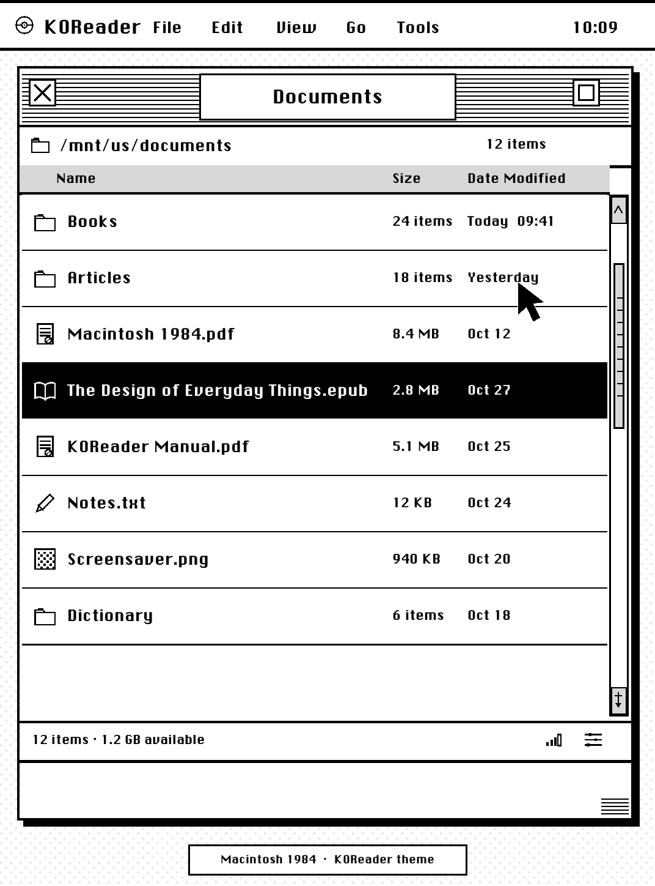

# Macintosh 1984 for KOReader

给 Kindle Paperwhite 4 上的 KOReader 使用的 1-bit Macintosh 1984 主题。
从 `v1.2.0` 开始，它同时是一个真正的 KOReader 插件，可以由 Storefront
安装和更新，不再依赖一次性的文件复制脚本。

已在 KOReader `v2026.07.2` + SimpleUI `3.0` 的 Kindle Paperwhite 4 上验证。

发布页：[github.com/hytaoist/mac1984-koreader/releases](https://github.com/hytaoist/mac1984-koreader/releases)

这是非官方粉丝主题，与 Apple 或 KOReader 项目没有隶属关系；"Macintosh" 在这里仅用于
描述视觉风格。



## 设计内容

- **103 个 KOReader 图标**：32 x 32、2 px 黑色描边、透明背景，覆盖当前
  `resources/icons/mdlight` 图标名，适合 300 ppi 电子墨水屏。
- **34 个 SimpleUI 图标**：自动部署为 `Macintosh 1984` 图标包，并切换到 ChicagoFLF。
- **ChicagoFLF 字体**：用于菜单、标题和按钮；中文和日文继续使用 KOReader 的 CJK
  fallback，不会出现方框。
- **经典窗口细节**：横向细条纹标题栏、中央标题牌、方形窗口、硬阴影、黑色规则线和
  圆角矩形按钮。
- **非侵入式安装**：不修改 KOReader 核心文件。图标、字体、SimpleUI 设置和主题运行时代码
  都可以从插件菜单恢复。


## Storefront 安装

发布仓库为 `hytaoist/mac1984-koreader`。仓库带 `koreader-plugin` topic，Release 中提供
Storefront 需要的 `.koplugin.zip`：

1. 打开 KOReader 的 **Storefront**。
2. 搜索 **Macintosh 1984**，或在 Storefront 的 GitHub 仓库入口填入：
   `hytaoist/mac1984-koreader`。
3. 安装后按提示重启 KOReader。
4. 以后在 Storefront 的 **Update All** 中即可接收主题更新。

Storefront 安装时会跟踪 GitHub 仓库，因此后续 Release 不需要重新安装。更新后的插件会在
KOReader 启动时刷新已经部署的图标、字体和 SimpleUI 图标包。

## OTA 更新

主题有两条 OTA 路径：

- **Storefront 安装**：使用 Storefront 的 **Update All** 或更新通知，插件会自动被替换。
- **手动安装**：打开 **工具 → Macintosh 1984 → Check for updates**，插件会读取 GitHub
  Releases 中最新版本的 `.koplugin.zip`，下载后替换自身，再提示重启。

更新时，`koreader/patches/2-mac1984.lua` 保持不变。它只是稳定加载器，会优先从当前
插件目录加载 `theme/apply.lua`，所以 Storefront 替换插件目录后，下一次启动立即使用新版
主题逻辑。部署版本记录在：

```text
koreader/.mac1984-theme/version
```

## 手动安装

连接 Kindle，让 `/Volumes/Kindle` 出现在 Finder 中，然后运行：

```bash
./install.sh /Volumes/Kindle
```

也可以直接指定 KOReader 目录：

```bash
./install.sh /Volumes/Kindle/koreader
```

脚本会完成以下工作：

- 安装 Storefront 兼容插件到 `koreader/plugins/mac1984-koreader.koplugin/`。
- 部署稳定补丁、运行时、103 个图标、字体和 SimpleUI 图标包。
- 修改 SimpleUI 的图标包路径和 UI 字体名。
- 记录每个被替换文件的原件，供后续恢复。

安装后完全退出 KOReader 再重新打开。若开启了“保持 KOReader 运行”，请先退出到
Kindle 主界面。

也可以把 `dist/mac1984-koreader-v1.2.2.koplugin.zip` 解压到
`koreader/plugins/`；首次启动时插件会自动部署主题并提示重启。

## 插件菜单

安装后可在 **工具 → Macintosh 1984** 中找到：

- **Reinstall / repair theme files**：重新部署当前版本的全部文件。
- **Disable and restore original files**：停用主题，并把图标和 SimpleUI 设置恢复到安装前。
- **Check for updates**：手动安装也可使用 GitHub Release OTA。
- **About**：查看插件版本、已部署版本、项目地址和赞助入口。

## 赞助支持

**工具 → Macintosh 1984 → About → Sponsor this project** 提供三种赞助入口：

- 在电子墨水屏上显示二维码，方便用手机扫码。
- 复制赞助链接到 KOReader 剪贴板。
- 在设备支持外部浏览器时直接打开赞助页面。

赞助地址由 `plugin/_meta.lua` 中的 `sponsor_url` 统一配置，不需要在界面代码中重复维护。

## 从 v1.1.0 升级

直接运行新版 `install.sh`，或从 Storefront 安装最新版。插件会识别旧版无前缀的
`installed.tsv`，并把旧备份迁移到新的 `backup/D/`、`backup/S/` 结构，不会覆盖原来的
备份文件。

## 卸载

推荐先在 **工具 → Macintosh 1984 → Disable and restore original files** 恢复文件，
再从 Storefront 或插件目录删除插件。

也可以使用命令行卸载：

```bash
./uninstall.sh /Volumes/Kindle
```

卸载会恢复安装前同名图标和 SimpleUI 字体/图标包，并删除主题部署文件。主题使用期间对
SimpleUI 其他选项的修改会尽量保留。

## 部署结构

```text
koreader/plugins/mac1984-koreader.koplugin/    Storefront 管理的插件
koreader/patches/2-mac1984.lua                 稳定用户补丁/加载器
koreader/.mac1984-theme/runtime/apply.lua      兼容旧安装的运行时副本
koreader/.mac1984-theme/backup/                原文件备份
koreader/icons/                                KOReader 图标
koreader/fonts/Mac1984Chicago.ttf              UI 字体
koreader/settings/simpleui/sui_icons/packs/Macintosh 1984/
```

插件只使用 KOReader 的公开模块和用户补丁机制。所有 UI 修改都有 `pcall` 保护；即使未来
KOReader 改变了某个控件接口，也不会阻止启动。

## 开关与细调

可以在 `koreader/settings.reader.lua` 中调整：

```lua
["mac1984_enabled"] = true,
["mac1984_pinstripes"] = false,  -- 关闭标题栏细条纹
["mac1984_shadows"] = false,     -- 关闭窗口硬阴影
```

只改文字可读性时，建议先关闭 `mac1984_pinstripes`。主题不会替换正文字体。

## 发布与开发

构建 Storefront 和手动安装包：

```bash
./build.sh
```

输出：

```text
dist/mac1984-koreader-v1.2.2.koplugin.zip  Storefront Release asset
dist/mac1984-koreader-v1.2.2.zip          手动安装包
dist/SHA256SUMS
```

Storefront 要求 Release asset 的 ZIP 根目录为 `mac1984-koreader.koplugin/`，且目录内有
`_meta.lua`。`build.sh` 会自动检查该结构，并拒绝错误的 ZIP 根目录。
ZIP 使用固定文件顺序、时间戳和权限生成，因此本机与 GitHub Actions 构建出的文件及
SHA-256 哈希保持一致。

首次发布仓库：

```bash
git init
git add .
git commit -m "Macintosh 1984 v1.2.2"
CREATE_GITHUB_REPO=1 ./publish.sh
```

后续发布只需要修改 `plugin/_meta.lua` 中的版本号、提交后运行：

```bash
./publish.sh
```

`publish.sh` 会推送 `v<version>` tag、设置 `koreader-plugin` topic，并上传
`.koplugin.zip`。仓库中的 `.github/workflows/release.yml` 也支持在推送 `v*` tag 时
自动构建和发布 Release。

## 测试

```bash
lua tests/patch_smoke_test.lua plugin/theme/apply.lua
lua tests/main_test.lua plugin/main.lua
lua tests/ota_test.lua plugin/ota.lua
./tests/run_loader_test.sh
./tests/run_deploy_test.sh
./tests/run_installer_test.sh
./tests/run_build_repro_test.sh
```

测试覆盖首次部署、重复安装、OTA 版本升级、旧版备份迁移、SimpleUI 设置恢复、卸载以及
Storefront ZIP 根目录校验。安装器测试还覆盖 macOS AppleDouble 元数据清理；构建测试会
连续构建两次并逐字节比较产物。图标由 `tools/generate_icons.py` 生成；字体许可见
`assets/fonts/LICENSE-ChicagoFLF.txt`。代码使用 MIT 许可，图标使用 CC0。
